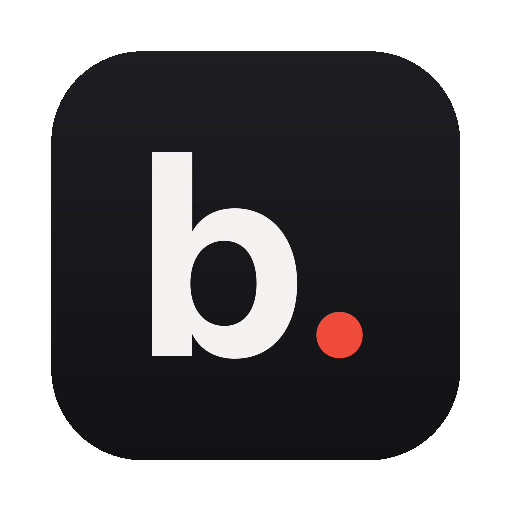
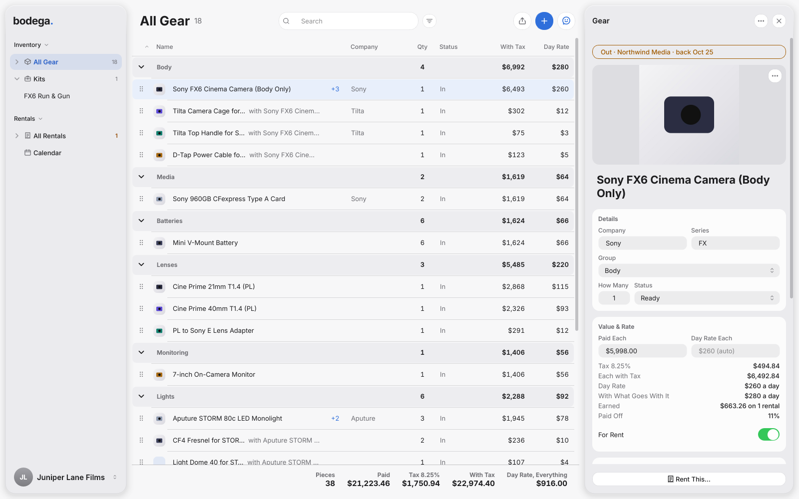

<p align="center"></p>

<h1 align="center">bodega.</h1>
<p align="center"><b>Keep track of your gear. Put it in kits. Rent it out.</b><br>
Every piece with its serial numbers, value and link, the gear that lives on it, kits with real pricing, and
rental agreements you can send. Runs on Mac, Windows and Linux.</p>

<p align="center"></p>

---

## Download

Click the one for your computer. These links always give you the newest version.

| Your computer | Download |
|---|---|
| Mac with Apple Silicon (M1 and newer) | **[Bodega for Mac (Apple Silicon)](https://github.com/nickvenecia/bodega/releases/latest/download/Bodega-mac-apple-silicon.dmg)** |
| Intel Mac | **[Bodega for Mac (Intel)](https://github.com/nickvenecia/bodega/releases/latest/download/Bodega-mac-intel.dmg)** |
| Windows | **[Bodega for Windows (installer)](https://github.com/nickvenecia/bodega/releases/latest/download/Bodega-windows-setup.exe)** · [portable .zip](https://github.com/nickvenecia/bodega/releases/latest/download/Bodega-windows-portable.zip) |
| Linux | **[Bodega for Linux (AppImage)](https://github.com/nickvenecia/bodega/releases/latest/download/Bodega-linux-x64.AppImage)** · [.tar.gz](https://github.com/nickvenecia/bodega/releases/latest/download/Bodega-linux-x64.tar.gz) |

Not sure which Mac you have? Apple menu → About This Mac: "Chip: Apple M…" means Apple Silicon. Every version is on the **[Releases page](https://github.com/nickvenecia/bodega/releases)**.

**Installing:**
- **Mac:** open the .dmg and drag Bodega into Applications. The app isn't signed with a paid Apple developer account yet, so the first time macOS says it can't check it: open **System Settings → Privacy & Security**, scroll down and click **Open Anyway**. Only once.
- **Windows:** run the installer (no admin needed). If SmartScreen pops up, click **More info → Run anyway**.
- **Linux:** make the AppImage runnable (right-click → Properties → Allow executing, or `chmod +x`) and double-click it.

Everything comes bundled, fonts included. No Python or terminal needed. Each time Bodega opens it checks for a new version
and, if there is one, shows what's new right away (**Later** closes it; **Update to …** stays at the bottom of the
sidebar).

## What it does

**Bring in the list you already keep.** Bodega starts empty. **Import Spreadsheet…** (the share button above the list) opens an Excel (.xlsx) or
.csv gear list in the Import window, where you see every piece before it comes in, untick departments or single
pieces, fix which column is which, and choose whether to attach gear and use the sheet's pricing. It reads lists laid
out by hand: it finds the Qty / Equipment / Cost / Rent? columns, turns headings like *Camera*, *G&E*, *Audio* into
departments and *Lenses*, *Steel*, *1000c* into groups, and even picks up the day-rate percent and sales tax from
your formulas. **Export Gear as CSV…** sends everything back out (and reads back in).

**Photos.** Give a piece a photo from a file, by dropping one on its panel, or from its link (the product page's
main picture; **File › Get Photos from Links…** does every piece at once). Photos show in the gear list and on the
inventory list and rate card. Bodega reads and saves every picture again before keeping it, so nothing else a file
carried comes along.

**Labels, check-out and check-in.** Print a QR sticker for every piece (**File › Print Labels…**, Avery 5160
sheets). When a rental goes out, **Check Out…** lists every piece: tick each one (or scan its sticker with any
USB scanner), note its condition, add photos. **Check In…** does the same when it comes back.

**What it's earned.** Each piece shows what it has made on rentals and how much of its cost it has paid back.

**Looking after it.** A maintenance log for every piece, with service reminders (Every 3 Months, say) and a
**Needs Service** filter.

**Cobro and your calendar.** **Send to Cobro…** turns a rental into a draft invoice in Cobro, the invoice
app. **Add to Calendar** puts pickups and returns in Apple Calendar; Google Calendar can import the same file.

**Gear that belongs to other gear.** A cage that only fits the FX6 belongs to the FX6. Attach it (**Belongs To**, or
**Attach Gear…** on the camera) and it folds under the camera in the list, goes wherever the camera goes, and shows up
under it on kits, rentals and agreements. On import, gear that says what it's for ("… for Sony FX6",
"CF4 Fresnel for STORM 80c") is attached for you, as a suggestion. The camera's row shows **+3** and the right
side lists them, each one click away. Attached gear is shared out sensibly:
renting 1 of your 3 lights sends 1 of its 2 fresnels.

**One screen, full size.** The sidebar picks the place (all gear, a department, kits, rentals, the calendar), the
middle is a big sortable table of it, and the right is the piece you picked, where you change it. If it's out or
booked, the top says so; click to open that rental. **Rent This…** starts a quote with it. Gear is divided by
department, and a bar under the table adds it all up like your sheet did: pieces, paid, tax, value with tax and
the day rate for everything. Light or dark follows your computer (View → Appearance), and you can pick the accent color in
Settings › General.

**Your order, your columns.** Drag gear by its grip to put it in the order you want (the other rows slide out of the way), or click a column title to
sort (by name, company, value…). Divide the list by department, group or company, or not at all. Right-click
the column titles to choose which show. Every piece has a **Company** and **Series** (the company is filled in
from the name for you).

**Only what a piece needs.** Link, Serial Numbers, Works With and Notes are added with **+ Add**, so a C-stand
doesn't carry empty serial number boxes. Duplicate and Delete are under **⋯**; **Rent This…** sits at the bottom.

**Groups, your way.** Gear is organised by group (Cameras, Lenses, Lights, Grip…), listed in the sidebar.
**Tidy Up Groups** (⋯, or on import) turns a sheet's headings into plain names: SD Cards becomes Media, 1000c
becomes Lights, a Pelican case goes in Cases & Carts. Make, rename and reorder groups; pick one on any piece,
or select several and **Move To…** (or drag them onto a group). Right-click a group for the rest. **Cmd+A** (or Shift and
Cmd-click) picks many; **Delete** deletes them, after a warning.

**Links and prices.** Links on your sheet's names come in with the gear (import the sheet again to add them to
gear you already have). **Import… → Google Sheets Link…** reads a Google Sheet straight from its link, links and
all (share it as *Anyone with the link* first). **Check Price** (the circle arrow beside a link) reads today's price from
the page and offers to use it. Some stores, B&H among them, don't let apps read their pages; then it says so.

**Every piece:** department and group, how many you own with a **serial number per unit**, what you paid, its
**replacement value** (with your sales tax), its day rate (automatic, or your own), a link, notes, and whether it's
**Ready**, **In Repair** or **Retired**. Search finds anything by name, serial number, group or note.

**Pricing that makes sense:**
- A day's rent is a percent of replacement value (4% to start, change it in your profile), rounded to whole dollars.
- **A week bills as 3 days** (the usual rental-house week; pick 2, 4, 5 or every day), so 5 days out costs 3 and
  10 days out costs 6. **Friday to Monday bills as 1 day** if you like.
- **Kits** cost what their gear adds up to, less a discount (15% to start), or a day rate you set. Bodega shows
  what renters save over renting piece by piece.

**Rentals, start to finish.** Start with a **Quote**, **Book** it (the gear is held for those dates), mark it **Out**,
then **Returned**. Pick a saved renter, add kits, gear and flat fees (delivery, a tech day), a discount, sales
tax and a refundable security deposit (**Suggest** works it out from replacement value).
- **Different dates on one rental.** Any line can have **Its Own Dates**: the FX6 kit Sunday to Sunday, the FX3
  kit Monday to Wednesday, same production, same agreement. Each line is billed for its own days.
- **No double-booking.** Gear that's already promised on overlapping dates, in repair, or more than you own is
  flagged on the line, with the rental it's on.
- **Out Now** and **Calendar** in the sidebar show what's out and what's coming; late returns show as **Late**.

**The paperwork:** the **Rental Agreement** (or **Quote**) with your logo, the renter, every piece with its serial
numbers and replacement value, Out / In check boxes for checking gear out and back in, grouped by date when lines
have their own dates, totals, your terms and signature lines. Plus the **Inventory List** (every piece and its value,
for insurance), the **Rate Card**, and a **Kit Sheet**. Each opens in its own window. **Save PDF…**, **Print…**, **Save as PNG…**, **Copy as
Text**, or **Email Renter** (opens a new email with the summary and shows the PDF to drag in).

**AI, with your own key.** Connect any AI you like in **AI → AI Settings…** (or Settings › AI): Anthropic, OpenAI,
Google Gemini, Kimi (Moonshot AI), OpenRouter, DeepSeek, Mistral, xAI, Groq, or any other OpenAI-compatible
service, including a model running on your own computer. Models are listed live from the provider. Then the
**AI Assistant** (the ✦ button, or ⌘J) can **Update from Links** (today's prices, cleaner names), **Find Missing
Links** (every link it suggests is opened and checked first), **Tidy Up Names** and **Organize Groups** (new groups where
they help), answer questions about your gear, or do what you ask ("put the Aputure lights in a group called Aputure"). Nothing changes until you approve it in the Review window, and a copy of your gear is kept first.

**Settings** (⌘,): light or dark, your profile and pricing, AI, your account, updates, and **Back Up…** (everything
in one zip file). **Send Feedback…** (Help, or ⋯) is ready for when feedback is switched on; until then messages
wait on your computer.

**Your data stays yours.** Everything is saved as small files on your computer only, as you type. Nothing is
uploaded, except what you choose to send to an AI: gear names and links (never renters or rentals).

## Privacy and security

- **Keys and sign-ins live in your computer's keychain** (macOS Keychain, Windows Credential Manager, the Linux
  Secret Service), never in a file. With no keychain, Bodega won't save a key at all.
- **Web pages are untrusted.** Links open only if they're web pages (https). Downloads only go to public internet
  addresses (never your computer or your home network), are size-capped, and are read safely. An AI's suggestions
  must fit a strict shape and are shown to you before anything changes.
- **Spreadsheets:** only web links come in; exported CSVs can't carry spreadsheet formulas; huge or booby-trapped
  files are refused.
- **Updates** come only from this repository's releases, must match their published checksum, and (on a signed
  Mac app) must be signed by the same developer.
- See [SECURITY.md](SECURITY.md) to report a problem.

## Run from source

```bash
git clone https://github.com/nickvenecia/bodega.git && cd bodega
python3 -m venv .venv && source .venv/bin/activate      # Windows: .venv\Scripts\activate
pip install -r requirements-dev.txt
python -m bodega                                       # the app
python -m bodega cli sample out.pdf --doc agreement    # a sample page, no window (agreement, quote, inventory, ratecard, package)
python -m bodega cli import GearList.xlsx out.pdf      # read a spreadsheet, save its inventory list
python -m pytest -q                                    # tests
```

Build the app yourself: `pyinstaller bodega.spec --noconfirm` → `dist/`.

## Making a release

Bump `__version__` in `bodega/__init__.py` and name a `CHANGELOG.md` section for it, in the pull request, then merge
it. When main has a version that isn't released yet, GitHub Actions builds the Mac (Apple Silicon and Intel),
Windows and Linux versions, tests each one, tags the commit `vX.Y.Z` and attaches them to a new Release. (Pushing a
tag `vX.Y.Z` by hand still works too.) To sign the Mac app, add the `MACOS_*` / `APPLE_*` secrets.

## Changing the icon
Run `python scripts/make_icon.py`, or replace `bodega/assets/icon.png` with a 1024×1024 PNG (transparent corners).

## License
Copyright © Nick Venecia.

Bodega's code is open source under GPL-3.0: you're welcome to read it, learn from it, change it and share it, as long
as what you share stays open source under the same license. The fonts it ships are under the SIL Open Font License;
see [THIRD_PARTY_NOTICES.md](THIRD_PARTY_NOTICES.md). The agreement's starting terms are a plain-language starting
point, not legal advice: have them looked over for your state.

### Name and icon
The name **Bodega**, the "bodega." wordmark and the app icon are **not** covered by the GPL. They belong to Nick
Venecia and identify the official app. If you publish a modified version, please give it a different name and icon.
